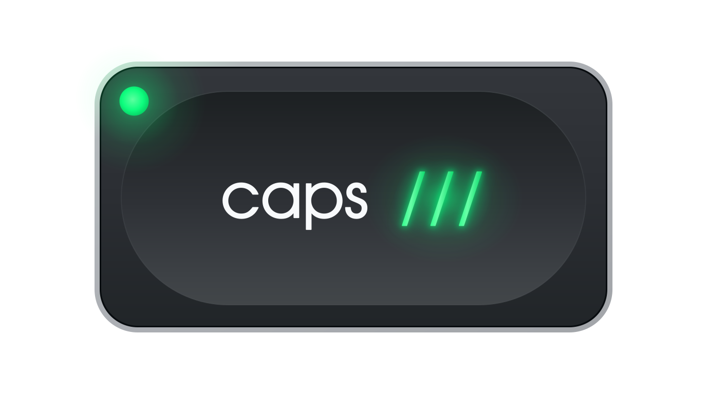

<p align="center">
  
</p>

# **CAPS: Cognitive AI Prompt Syntax**
### *A Symbolic, Hierarchical DSL & Cognitive Framework for Deterministic Human-to-AI Interaction*

[](CAPS-DSL.md)
[](LICENSE)

**CAPS (Cognitive AI Prompt Syntax)** is a declarative, asymmetric, write-only Domain-Specific Language (DSL) and human-to-agent communication protocol engineered to maximize intent precision, token efficiency, and deterministic parsing in Large Language Model (LLM) workflows.

---

## Why CAPS?

1. **Transformer Attention Anchoring ($Q \times K^T$):** Standard conversational prose produces diffuse self-attention distributions where models must infer intent from surrounding filler. CAPS prefixes (`-`, `?`, `>`, `!`, `:`, `=`, `///`) serve as high-contrast semantic anchors that explicitly separate static context from executable directives, uncertainties, diagnostic symptoms, and state transitions.
2. **Hierarchical Scope Isolation:** Indentation via symbol repetition (`--`, `>>>`, `::::`) or integer compression (`2-`, `3>`) constructs a strict Abstract Syntax Tree (AST). Child nodes elaborate exclusively on their direct parent node, preventing local constraints or sub-queries from leaking globally across the prompt.
3. **Cognitive Pre-Processing (QIQO):** Beyond machine parsing, CAPS acts as a *"Quality In, Quality Out"* mental framework—guiding the author to decouple baseline facts (`-`), desired actions (`>`), target results (`=`), uncertainties or queries (`?`), and diagnostic errors (`!`) before prompting.
4. **Asymmetric Design Contract:** CAPS is strictly a **Human-to-AI** input syntax. The user prompts in CAPS; the AI agent parses the hierarchy deterministically and responds in standard natural language and Markdown.

---

## Quick Syntax Overview

| Symbol | Type | Purpose |
| :--- | :--- | :--- |
| `-` | **CONTEXT** | Baseline state, environment, facts, or system settings (informational). |
| `?` | **QUERY** | Uncertainties, questions, or proposed variants requiring analysis. |
| `>` | **ACTION** | Explicit commands, tasks, directives, or negative constraints (`> Do not...`). |
| `!` | **ERROR / SYMPTOM** | Bugs, exceptions, stack traces, or broken behavior to diagnose/resolve. |
| `:` | **BEFORE** | Input pattern, reference code, or initial state prior to modification. |
| `=` | **AFTER / RESULT** | Output pattern, target state, or desired transformation result. |
| `///` | **TOPIC / MILESTONE BOUNDARY** | Establishes the overarching **Prime Topic** at session start, or confirms the previous **Sub-Topic** is completed and initiates a new **Sub-Topic** mid-session. |
| `~~~` | **BLOCK FENCE** | Encloses multi-line literal payloads (code, logs, configs) inheriting the parent node's scope. |

### Operational Shorthand Macros

| Macro | Alias | Scope | Meaning |
| :--- | :--- | :--- | :--- |
| `>www` | `>w` | `Turn` | **Web Search:** Search the web for current, authoritative info. |
| `>test` | `>=` | `Turn` | **Empirical Test:** Run tests, syntax checks, or state inspection. |
| `=chat` | `=?` | `Turn` | **Advisory Only:** Read-only analysis; do not modify files or state. |
| `=min` | `=-` | `Turn` | **Minimal Output:** Direct answer or code only, no explanations. |
| `=max` | `=+` | `Turn` | **Deep Mechanics:** Exhaustive breakdown of edge cases and *"Why"*. |
| `>step` | `>%` | **`Session`** | **Step-by-Step:** Pause for confirmation after each step. |
| `>time` | `>t` | **`Session`** | **Timestamp:** Append local `YYYY-MM-DD HH:MM:SS` to responses. |
| `-chrome` | `-//` | **`Session`** | **Browser CDP:** Connect to live Chrome CDP session when needed. |
| `-sudo` | `-$` | **`Session`** | **Elevated Access:** Full `sudo`/`root` privileges granted. |
| `=&{lang}` | — | **`Session`** | **Target Language:** Force output in ISO 639-1 code (e.g., `=&cs`, `=&de`). |

> **Scope & Negation (`.` Suffix):**
> * `Turn` applies to the current prompt (or nested subtree); `Session` persists across `///` boundaries.
> * Append `.` to turn **OFF** or **suppress** a macro:
>   * On `Session` macros: deactivates or locks out (`>t.`, `>%.`, `-$.` = *no `sudo`*, `-//.` = *no Chrome*).
>   * On `Turn` macros: suppresses for this turn/subtree (`>w.` = *no web search*, `>=.` = *skip tests*).

---

## Examples

Authentic real-world CAPS prompts showing how baseline context, execution controls, multi-line requirements, scoped constraints, and open questions fit into a deterministic hierarchy.

### SW

```text
/// Keypress Recorder/Replayer
-$
>w
=?
- I have 2 external monitors connected to my laptop
- I work with several virtual desktops (workspaces) and usually have 2–3 windows on each monitor
-- Each app window has a fixed position
-- Arranging all workspaces and windows usually takes a few minutes
--- I do this using many different keyboard shortcuts (hotkeys)
---- e.g., placing Double Commander: "Ctrl+5...Super+ArrowUp...Super+Shift+ArrowLeft...Super+ArrowLeft"
--- Every time I reboot the system, I spend several minutes restoring my workspaces, which is annoying and inefficient
= A terminal tool (or set of tools) that:
~~~
1. records my keyboard input sequence
2. saves the sequence to a file with a user-specified name (e.g., "sap_session")
3. replays/executes the sequence on demand so the workspaces and windows are arranged the exact same way as if I had opened and placed them manually
~~~
?? I guess a Python script is the best fit here
== The tool must be able to record and replay all kinds of keys and keyboard shortcuts
--- Except system interrupt combinations like "Ctrl+C", of course
== The tool should preserve the exact delay between every key or hotkey
--- e.g., the following sequence launches Chrome and opens a new tab: "Super ...(1000ms)...c...(200ms)...h...(200ms)...r...(200ms)...o...(200ms)...Enter ...(3000ms)...Ctrl+T"
== There should also be a simple config file for adjusting key parameters and options
--- e.g., target output directory, extra delay between keyboard shortcuts (hotkeys), etc.
```

### OS

```text
/// Free Drive Space
-$
=?
- A few weeks ago, I had around 180 GB of free space on the system drive, and now there is 150 GB
?? What happened?
> Check the system for stale/expendable/cached/residual files that can be safely deleted
-- You can use my utility:
~~~
➜  ~ capsize_big           
51G    total
17G    Dev
8.7G   .cache
7.5G   .local
5.6G   .config
2.5G   Documents
1.6G   Downloads
781M   .mozilla
715M   snap
399M   .ui5
~~~
```

### Law / Subagents

```text
/// New Agent "Lawyer (Real Estate Specialist)"
- I have several folders on my system for real estate administration
-- Mostly lease agreements
-- They contain contracts, amendments, etc.
--- Mostly in .docx format, but I have prepared a workflow using "_raw" subfolders that will contain conversions of these .docx files into clean .md (Markdown)
= A specialized AI agent with the role of a lawyer specializing in real estate and related transactions
== This AI agent should be active only within the scope of the folder /home/user/Documents/RealEstate
?? It could probably be defined with instructions similar to the custom Gem agent (final hybrid)
? I have never set up such a specialized agent on the system before and do not know the optimal approach
> Find the current/modern way to create and manage such an agent in the Antigravity environment
>>w
?? I assume the principle will be similar for other platforms like LLM-frontier2 or LLM-frontier3
```

### Key Takeaways

* **Deterministic Agent Controls (`-$`, `>w`, `=?`, `>>w`):** Top-level macros govern the entire turn (`-$` grants elevated diagnostics, `=?` enforces read-only advisory mode), while nested `>>w` scopes web search strictly to its parent `>` directive.
* **Strict Scope Isolation (`-` → `----`, `=` → `---`):** Constraints like `"Ctrl+C"` exclusion (*SW*), `_raw` conversion context (*Law / Subagents*), and folder scoping attach exclusively to their parent node instead of leaking globally.
* **Block Inheritance (`~~~`):** Multi-line specifications (*SW*) and terminal outputs (*OS*) inherit their parent node's scope (`=` or `--`) without repeating prefixes on every line.
* **More Examples:** See [CAPS-DSL.md](CAPS-DSL.md) (including `!` error symptoms and `:` → `=` code transitions) and the 7 domain showcases in [examples/](examples/).

---

## Repository Structure

* **[CAPS-DSL.md](CAPS-DSL.md)** — The full canonical RFC-style specification, including architectural foundations, lexical rules, multi-domain integration examples, and the formal ISO/IEC 14977 EBNF grammar.
* **[CAPS-DSL.txt](CAPS-DSL.txt)** — Exact plaintext mirror of `CAPS-DSL.md` for universal ingestion across tools and web interfaces.
* **[CAPS.md](CAPS.md)** — Condensed, token-optimized specification (~5.7 KB) designed for direct embedding into AI system prompts, custom instructions, and agent rule files (e.g., `GEMINI.md`, `CLAUDE.md`, `.cursorrules`).
* **[LICENSE](LICENSE)** — Creative Commons Attribution-ShareAlike 4.0 International (`CC-BY-SA-4.0`) license text.
* **[assets/](assets/)** — Official CAPS brand assets in vector ([caps-logo.svg](assets/caps-logo.svg)) and full-resolution raster ([caps-logo.png](assets/caps-logo.png)) formats.
* **[examples/](examples/)** — Curated, anonymized real-world CAPS prompts across 7 domains:
  * [AI Engineering & Agent Orchestration](examples/CAPS_log-bestof_AI.md)
  * [Linux & OS Administration](examples/CAPS_log-bestof_Linux.md)
  * [Personal & Legal Workflows](examples/CAPS_log-bestof_Personal.md)
  * [Python Automation & Document Processing](examples/CAPS_log-bestof_Python.md)
  * [SAP Enterprise Development (ABAP Cloud, RAP, CDS, Fiori, BTP)](examples/CAPS_log-bestof_SAP.md)
  * [Shell Scripting & CLI Utilities](examples/CAPS_log-bestof_Shell.md)
  * [Web, Cloud & Firebase Development](examples/CAPS_log-bestof_Web.md)

---

## Quick Start: Adding CAPS to Your AI Agent

To enable native CAPS comprehension in your AI coding assistant or LLM environment, add the contents of **[CAPS.md](CAPS.md)** to your global system prompt or agent rules file alongside these two directives:

```markdown
* The user can prompt you using the **CAPS (Cognitive AI Prompt Syntax)**.
* When CAPS is used, parse the user's inputs according to the semantic symbols (`-`, `?`, `>`, `!`, `:`, `=`, `///`) and hierarchical nesting defined by the CAPS protocol.
* CAPS is strictly for user inputs. Do not use CAPS syntax in your responses.
```

---

## License & Attribution

**CAPS: Cognitive AI Prompt Syntax** is © 2026 **Jakub Capsky** and is licensed under the **[Creative Commons Attribution-ShareAlike 4.0 International License (CC BY-SA 4.0)](LICENSE)** ([summary](https://creativecommons.org/licenses/by-sa/4.0/)).

---

## Support

If CAPS saves you time or provides extra value in your workflows, you are welcome to support its continued evolution:

[](https://github.com/sponsors/capsky-jakub)
[](https://ko-fi.com/capskyjakub)
