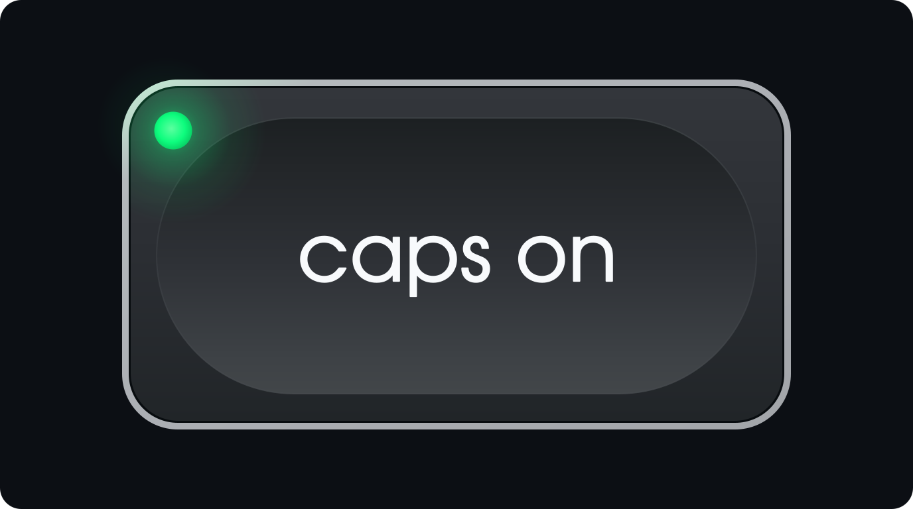

<p align="center">
  
</p>

# **CAPS: Cognitive AI Prompt Syntax**
### *A Symbolic, Hierarchical DSL & Cognitive Framework for Deterministic Human-to-AI Interaction*

[](CAPS-DSL.md)
[](LICENSE)

**CAPS (Cognitive AI Prompt Syntax)** is a declarative, asymmetric, write-only Domain-Specific Language (DSL) and human-to-agent communication protocol engineered to maximize intent precision, token efficiency, and deterministic parsing in Large Language Model (LLM) workflows.

---

## Why CAPS?

1. **Transformer Attention Anchoring ($Q \times K^T$):** Standard conversational prose produces diffuse self-attention distributions where models must infer intent from surrounding filler. CAPS prefixes (`-`, `?`, `>`, `!`, `:`, `=`, `///`) serve as high-contrast semantic anchors that explicitly separate static context from executable directives, uncertainties, diagnostic symptoms, and state transitions.
2. **Hierarchical Scope Isolation:** Indentation via symbol repetition (`--`, `>>>`, `::::`) or integer compression (`2-`, `3>`) constructs a strict Abstract Syntax Tree (AST). Child nodes elaborate exclusively on their direct parent node, preventing local constraints or sub-queries from leaking globally across the prompt.
3. **Cognitive Pre-Processing (QIQO):** Beyond machine parsing, CAPS acts as a *"Quality In, Quality Out"* mental framework—guiding the author to decouple baseline facts (`-`), desired actions (`>`), target results (`=`), uncertainties or queries (`?`), and diagnostic errors (`!`) before prompting.
4. **Asymmetric Design Contract:** CAPS is strictly a **Human-to-AI** input syntax. The user prompts in CAPS; the AI agent parses the hierarchy deterministically and responds in standard natural language and Markdown.

---

## Quick Syntax Overview

| Symbol | Type | Purpose |
| :--- | :--- | :--- |
| `-` | **CONTEXT** | Baseline state, environment, facts, or system settings (informational). |
| `?` | **QUERY** | Uncertainties, questions, or proposed variants requiring analysis. |
| `>` | **ACTION** | Explicit commands, tasks, directives, or negative constraints (`> Do not...`). |
| `!` | **ERROR / SYMPTOM** | Bugs, exceptions, stack traces, or broken behavior to diagnose/resolve. |
| `:` | **BEFORE** | Input pattern, reference code, or initial state prior to modification. |
| `=` | **AFTER / RESULT** | Output pattern, target state, or desired transformation result. |
| `///` | **BOUNDARY / NEW** | Hard logical break confirming the previous task is complete and resetting context. |
| `~~~` | **BLOCK FENCE** | Encloses multi-line literal payloads (code, logs, configs) inheriting the parent node's scope. |

### Operational Shorthand Macros

| Macro | Alias | Meaning |
| :--- | :--- | :--- |
| `>www` | `>w3` | **Web Search:** Actively search the web for current, authoritative information. |
| `>step` | `>%` | **Step-by-Step:** Proceed interactively one step at a time, pausing for confirmation. |
| `>test` | `>=` | **Empirical Test:** Verify the solution empirically (tests, syntax checks, state inspection). |
| `-sudo` | `-$` | **Elevated Access:** Full administrative (`sudo`/`root`) privileges are granted. |
| `=chat` | `=?` | **Advisory / Chat Only:** Read-only mode; analyze and propose without modifying state. |
| `=min` | `=-` | **Minimal Output:** Omit explanations; output only the direct answer or code block. |
| `=max` | `=+` | **Deep Mechanics:** Provide an exhaustive breakdown explaining underlying mechanics and "Why". |
| `=@{lang}` | — | **Target Language:** Force output generation in the specified ISO 639-1 language (e.g., `=@cs`, `=@de`). |

---

## Repository Structure

* **[CAPS-DSL.md](CAPS-DSL.md)** — The full canonical RFC-style specification, including architectural foundations, lexical rules, multi-domain integration examples, and the formal ISO/IEC 14977 EBNF grammar.
* **[CAPS-DSL.txt](CAPS-DSL.txt)** — Exact plaintext mirror of `CAPS-DSL.md` for universal ingestion across tools and web interfaces.
* **[CAPS.md](CAPS.md)** — Condensed, token-optimized specification (~5.7 KB) designed for direct embedding into AI system prompts, custom instructions, and agent rule files (e.g., `GEMINI.md`, `CLAUDE.md`, `.cursorrules`).
* **[LICENSE](LICENSE)** — Creative Commons Attribution-ShareAlike 4.0 International (`CC-BY-SA-4.0`) license text.
* **[assets/](assets/)** — Official CAPS brand assets in vector ([caps-logo.svg](assets/caps-logo.svg)) and full-resolution raster ([caps-logo.png](assets/caps-logo.png)) formats.
* **[examples/](examples/)** — Curated, anonymized real-world CAPS prompts across 7 domains:
  * [AI Engineering & Agent Orchestration](examples/CAPS_log-bestof_AI.md)
  * [Linux & OS Administration](examples/CAPS_log-bestof_Linux.md)
  * [Personal & Legal Workflows](examples/CAPS_log-bestof_Personal.md)
  * [Python Automation & Document Processing](examples/CAPS_log-bestof_Python.md)
  * [SAP Enterprise Development (ABAP Cloud, RAP, CDS, Fiori, BTP)](examples/CAPS_log-bestof_SAP.md)
  * [Shell Scripting & CLI Utilities](examples/CAPS_log-bestof_Shell.md)
  * [Web, Cloud & Firebase Development](examples/CAPS_log-bestof_Web.md)

---

## Quick Start: Adding CAPS to Your AI Agent

To enable native CAPS comprehension in your AI coding assistant or LLM environment, add the contents of **[CAPS.md](CAPS.md)** to your global system prompt or agent rules file alongside these two directives:

```markdown
* The user can prompt you using the **CAPS (Cognitive AI Prompt Syntax)**.
* When CAPS is used, parse the user's inputs according to the semantic symbols (`-`, `?`, `>`, `!`, `:`, `=`, `///`) and hierarchical nesting defined by the CAPS protocol.
* CAPS is strictly for user inputs. Do not use CAPS syntax in your responses.
```

---

## License & Attribution

**CAPS: Cognitive AI Prompt Syntax** is © 2026 **Jakub Capsky** and is licensed under the **[Creative Commons Attribution-ShareAlike 4.0 International License (CC BY-SA 4.0)](LICENSE)** ([summary](https://creativecommons.org/licenses/by-sa/4.0/)).

---

## Support

If CAPS saves you time or provides extra value in your workflows, you are welcome to support its continued evolution:

[](https://github.com/sponsors/capsky-jakub)
[](https://ko-fi.com/capskyjakub)
